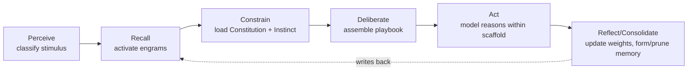
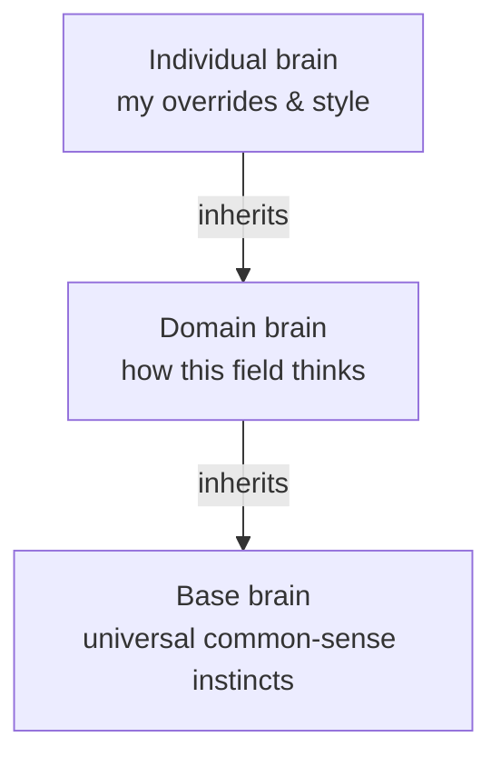

# Digital Brain — Data Model & Schema

> Status: design draft · Last updated: 2026-09-14

## Thesis

A **portable, model-agnostic cognition layer** where the *identity and method of reasoning*
lives with the person or domain — not with the model vendor. The AI model is a swappable
"processor"; the brain is the "OS + memory" that tells it *how this particular entity thinks*.

**The test for every feature:** *Does this let someone swap one model for a future model and
keep reasoning exactly like themselves, without re-writing their instructions?* If yes, it
belongs. If no, it's a nice-to-have.

The differentiator vs. a system prompt or plain RAG:

1. **Typed & structured** — distinct kinds of knowledge that activate differently.
2. **Contextually activated** — only relevant parts "light up" per task (attention/salience).
3. **Self-evolving** — learns from outcomes and *warps* without manual re-prompting.
4. **Composable & portable** — one brain across many apps; brains layer.
5. **Auditable & editable** — you can inspect "how I think"; models can edit it when told to.

---

## Context: the thought cycle this schema serves

Everything below exists to power one loop (full protocol lives in a separate doc):



Fast path (routine): short-circuit **Deliberate** using always-on instincts.
Slow path (novel/hard): run the full loop.

---

## The atom: the Engram

Every memory — fact, case, playbook, or law — is an engram. Shared fields carry the
*plasticity* machinery; a discriminated `type` carries the payload.

```ts
type Engram = {
  id: string;
  brain_id: string;              // which brain owns it (for layering)
  type: 'semantic' | 'episodic' | 'procedural' | 'value';
  region: string;                // functional scope; domain-definable
  content: EngramContent;        // varies by type (below)
  embedding: number[];           // vector, for semantic recall

  // ── plasticity (the "warps & evolves" levers) ──
  salience: number;              // 0–1, current activation weight → drives ranking
  base_salience: number;         // floor it decays toward (intrinsic importance)
  decay_rate: number;            // how fast salience bleeds toward base
  activation_count: number;      // times recalled
  success_count: number;         // times recalled AND outcome was good
  last_activated_at: Date;

  // ── provenance & trust ──
  source: 'human' | 'consolidated' | 'model_proposed';
  status: 'active' | 'draft' | 'quarantined' | 'pruned';
  confidence: number;

  // ── activation conditions ──
  triggers: string[];            // intents/tags/conditions that light it up
  layer_priority: number;        // cascade resolution (see Brains)
  created_at: Date;
};
```

### Type-specific payloads

The four classic memory systems become a discriminated union:

```ts
type EngramContent =
  // "what is true in this domain"
  | { kind: 'semantic'; concept: string; definition: string; facts: string[] }

  // "what happened when I did X" — raw material for consolidation
  | { kind: 'episodic'; situation: string; action: string;
      outcome: string; valence: number /* -1..1 */; refs: string[] }

  // "HOW I do X" — the core of "my way of doing things".
  // steps[] ARE the reasoning scaffold handed to the model.
  | { kind: 'procedural'; name: string; preconditions: string[];
      steps: string[]; expected_outcome: string; examples: string[] }

  // Constitution (hard) + Instinct (soft) live here
  | { kind: 'value'; rule: string; enforcement: 'hard' | 'soft';
      scope: string; rationale: string };
```

- **`enforcement: 'hard'` → Constitution:** invariant law, checked at cycle steps 3 *and* 6.
  `decay_rate: 0`, never auto-pruned, status changes require human approval.
- **`enforcement: 'soft'` → Instinct:** an always-loaded default (no retrieval needed — it's
  ambient for its scope). Soft *do-by-default*, vs. Constitution's hard *don't*.

---

## Associations (Hebbian wiring)

Edges make this a brain and not a list. Retrieving one engram spreads activation to neighbors.

```ts
type Association = {
  from: string; to: string;
  kind: 'supports' | 'contradicts' | 'refines' | 'causes'
      | 'example_of' | 'part_of' | 'co_activated';
  weight: number;                // grows each time both fire in a successful cycle
  last_reinforced_at: Date;
};
```

`contradicts` edges detect cognitive dissonance → flip both engrams to `quarantined`
for reconciliation.

---

## Brains & the layering cascade

```ts
type Brain = {
  id: string; name: string;
  kind: 'base' | 'domain' | 'individual';
  parent_id?: string;            // individual → domain → base
  regions: string[];
  autonomy: AutonomyPolicy;      // see below
};
```



Two resolution rules:

1. **Preference cascade:** on conflicting *soft* engrams, higher layer wins
   (`individual > domain > base`) via `layer_priority`.
2. **Constitution monotonicity (invariant):** hard constraints can only **tighten** going up
   the stack, never loosen — like local law can be stricter than federal, never looser. An
   individual brain can *add* red lines to a domain's Constitution but can't *remove* one.
   Keeps identity flexible while keeping safety non-negotiable.

---

## Retrieval = attention

Recall isn't just vector search — it computes an **activation score** blending five signals,
mirroring how attention surfaces memory:

```
score = w1·cosine_sim(stimulus, engram)   // relevance
      + w2·salience                       // learned importance
      + w3·assoc_boost                    // spreading activation from already-lit engrams
      + w4·recency
      + w5·|valence|                      // emotionally-tagged memories surface easier
```

The plasticity engine is the set of jobs that write back to `salience`, `success_count`,
and edge `weight` after each cycle.

---

## Autonomy — a configurable write-gate policy

Default is **human-gated**, with a per-brain (and per-region) toggle to raise it.

```ts
type AutonomyLevel = 'gated' | 'guarded' | 'autonomous';

type AutonomyPolicy = {
  default_level: AutonomyLevel;                 // 'gated' by default
  region_overrides: Record<string, AutonomyLevel>;
  // INVARIANT: Constitution (value/hard) changes are ALWAYS 'gated',
  // regardless of level. The identity/safety floor.
};
```

### What each level gates

The plasticity engine performs a fixed set of write operations, ranked by risk. The level
decides which auto-apply vs. land in the review queue:

| Write op | Risk | Gated (default) | Guarded | Autonomous |
|---|---|---|---|---|
| Salience ↑/↓ (reinforce/decay) | low | auto | auto | auto |
| Association weight change | low | auto | auto | auto |
| New association edge | low-med | auto | auto | auto |
| New engram (consolidation) | med-high | **draft** | auto | auto |
| Engram content edit | high | **draft** | auto | auto |
| Prune (→ pruned) | med | **draft** | auto | auto |
| Resolve a `contradicts` conflict | high | **draft** | **draft** | auto |
| **Constitution (hard value) change** | critical | **draft** | **draft** | **draft** |

- Even at **gated**, quantitative/reversible signals (salience, edge weights) always auto-apply
  — otherwise the brain can't learn what to surface, and trivial approvals would drown the user.
  The gate is only for changes to *what you think*, not *what's top-of-mind*.
- **Constitution stays human-only at every level.** If a fully-autonomous brain could rewrite
  its own red lines, the safety story collapses. Overridable, but not recommended.

---

## Safety mechanisms (what makes higher autonomy defensible)

1. **Batched review queue** — drafts collect in a review inbox; approve/reject/edit in batch.
   No interruptions. Low friction is what keeps "gated" from being annoying enough that users
   flip to autonomous just to escape it.

2. **Event-sourced brain state + rewind** — the brain is the fold of an append-only event log
   (`stimulus → cycle → writes`), not just mutable rows. This buys:
   - **Full audit** — "*why* do I now approach X this way?" traces to the episodes that
     consolidated it.
   - **Rewind / time-travel** — revert bad drift like `git revert`. Autonomy is only
     responsible if reversible.
   - **Consolidation fuel** — replay episodic events to abstract new procedures.

   Autonomous mode is defensible *because* every write is journaled and undoable.

---

## Trust ramp (earned autonomy per region)

Mirror how you delegate more to a person as they prove reliable: a region's autonomy is
*earned*, not flipped blind.

```ts
type TrustState = {
  region: string;
  reviews: number;               // drafts the human has acted on
  accept_rate: number;           // approved / reviews
  suggested_level?: AutonomyLevel; // brain's promotion suggestion
};
```

- The brain tracks, per region, how often its drafts are accepted vs. rejected/edited.
- Once a region clears a threshold (e.g. ≥ 20 reviews at ≥ 90% accept-rate), the brain
  *suggests* promoting it `gated → guarded` (or `guarded → autonomous`). The human confirms.
- A demotion trigger works in reverse: a burst of rejections or a rewind auto-drops the region
  back a level and re-queues its recent autonomous writes for review.
- Promotion is always per-region, never a global blind switch. You grow trust where the brain
  has proven itself and keep high-stakes regions gated.

---

## Storage recommendation

Requirements: vector recall + relational plasticity counters + light graph traversal +
background consolidation. Don't split across three databases yet — **Postgres + pgvector**
does all four: vectors, plasticity counters as columns, and association traversal via recursive
CTEs. Reach for a dedicated graph DB *only if* multi-hop spreading activation becomes the
measured bottleneck. (Managed fit here: Neon via the Vercel Marketplace when provisioning.)

Event log is an append-only table; current engram/edge rows are a materialized fold of it.

---

## Worked example (litigator brain)

1. Stimulus: *"opposing counsel missed the discovery deadline."*
2. **Recall** lights up a `procedural` engram *"respond to a missed deadline"* (high salience,
   fired often) + an `episodic` case where a motion to compel worked.
3. **Constrain** loads the hard `value` rule *"never threaten sanctions without partner sign-off."*
4. Model executes the playbook's `steps[]` within that constraint.
5. Outcome good → `success_count++`, salience rises, the procedural↔episodic `co_activated`
   edge strengthens.
6. After the 5th similar episode, **consolidation** abstracts them into a new `procedural`
   engram (`source: 'consolidated'`, `status: 'draft'`) for the human to confirm — *the
   auto-written playbook that replaces re-prompting.*

---

## Open questions / next docs

- **Plasticity engine** (next) — the jobs that turn the fields above: reinforcement, decay,
  Hebbian association, consolidation, pruning, conflict detection.
- **Thought-cycle protocol** — the model-facing API/MCP contract for the 6-step loop.
- **MVP domain slice** — a thin end-to-end vertical in one domain to prove the concept.
- Feedback signal: where does the reinforcement outcome signal come from (explicit rating vs.
  implicit acceptance vs. downstream task success)?
